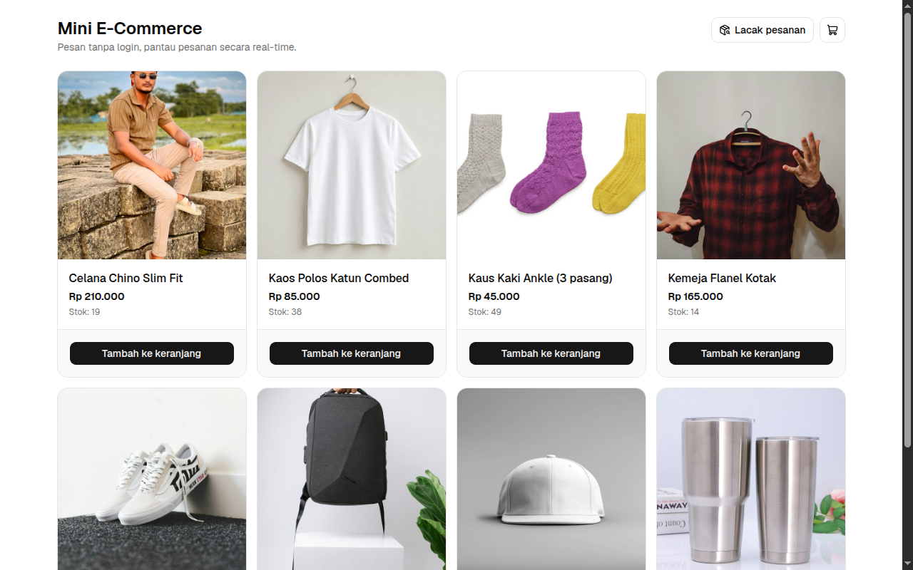

# Mini E-Commerce & Realtime Dashboard

Web pemesanan sederhana untuk usaha kecil. Pelanggan bisa memesan beberapa produk sekaligus **tanpa membuat akun**, sedangkan admin memantau setiap pesanan yang masuk **secara real-time** dari dashboard.

**Demo:** https://awm-fullstack.vercel.app · Dashboard admin: https://awm-fullstack.vercel.app/admin



## Fitur

**Pelanggan (tanpa login)**
- Katalog produk berisi gambar, harga, dan stok. Produk yang stoknya habis tidak bisa dibeli.
- Keranjang multi-produk dengan pengaturan jumlah. Isi keranjang tetap ada walaupun halaman dimuat ulang.
- Checkout cukup dengan nama, nomor HP, dan alamat. Pelanggan mendapat kode pesanan unik.
- Lacak pesanan dengan kode pesanan **atau** nomor HP.

**Admin (login)**
- Ringkasan: total omzet, jumlah pesanan, barang terjual, dan pesanan yang menunggu diproses.
- Grafik omzet 7 hari terakhir dan 5 produk terlaris.
- Tabel transaksi dengan filter status dan rincian barang.
- Ubah status pesanan: Menunggu → Diproses → Selesai, atau Dibatalkan (stok dikembalikan).
- Pesanan baru muncul otomatis tanpa refresh, disertai notifikasi.

**Keamanan & integritas data**
- Harga dan total dihitung ulang oleh database, jadi harga yang diubah dari browser diabaikan.
- Stok dicek dan dikurangi dalam satu transaksi dengan penguncian baris, sehingga stok tidak bisa minus walaupun dua orang membeli bersamaan.
- Data pesanan dilindungi Row Level Security (RLS) dan hanya bisa dibaca admin.

## Teknologi

| Bagian | Pilihan |
|---|---|
| Frontend & server | Next.js 16 (App Router, TypeScript) |
| Tampilan | Tailwind CSS 4 + shadcn/ui, grafik dengan Recharts |
| Database, Auth, Realtime | Supabase (PostgreSQL) |
| Hosting | Vercel |
| AI Tool | Claude Code |

## Arsitektur Singkat

```
Browser ──► Next.js (Vercel) ──► Supabase
             │                    ├─ Postgres + RLS
             │                    ├─ Fungsi DB: create_order, track_orders,
             │                    │  update_order_status, get_dashboard_stats
             │                    ├─ Auth (login admin)
             └◄── Realtime ◄──────┘  (perubahan tabel orders → dashboard)
```

- **Tanpa API server sendiri.** Aplikasi memanggil fungsi database lewat `supabase-js`. Logika penting (hitung harga, cek stok, transisi status) berjalan di database dalam satu transaksi.
- **Proteksi admin dua lapis:** `src/proxy.ts` mengarahkan pengunjung tanpa role admin ke halaman login, dan RLS memeriksa `is_admin()` sebelum data dikirim.
- **Real-time:** tabel `orders` masuk publication `supabase_realtime`. Dashboard berlangganan perubahan tabel itu lalu mengambil ulang data.

Detail lengkap ada di [PRD](docs/PRD.md), [ERD](docs/ERD.md), dan [Flowchart](docs/FLOWCHART.md).

## Struktur Folder

```
src/
  app/                  halaman: katalog (/), /checkout, /checkout/success, /track, /admin, /admin/login
  components/           komponen halaman (keranjang, form checkout, tabel transaksi, dll.)
  components/ui/        komponen shadcn/ui
  lib/                  keranjang (localStorage), label status, format Rupiah, client Supabase
  proxy.ts              proteksi rute /admin
supabase/
  migrations/           skema, RLS, dan fungsi database (dijalankan berurutan)
  seed.sql              8 produk contoh
docs/                   PRD, ERD, Flowchart, User Guide, Prompt Log, Issues, screenshots
```

## Menjalankan dari Nol

**Kebutuhan:** Node.js 20.9 atau lebih baru, akun [Supabase](https://supabase.com) (paket gratis cukup), dan `psql` (opsional).

### 1. Clone & install

```bash
git clone https://github.com/arikmhm/awm-fullstack.git
cd awm-fullstack
npm install
```

### 2. Siapkan database Supabase

1. Buat project baru di Supabase Dashboard.
2. Jalankan file di `supabase/migrations/` **sesuai urutan nama file**, lalu `supabase/seed.sql`. Pilih salah satu cara:
   - **SQL Editor:** salin isi setiap file ke SQL Editor lalu klik *Run*, satu per satu.
   - **psql:** ambil connection string di *Connect → Type: URI → Session pooler*, lalu:

     ```bash
     for f in supabase/migrations/*.sql supabase/seed.sql; do psql "$DATABASE_URL" -v ON_ERROR_STOP=1 -f "$f"; done
     ```
3. Matikan pendaftaran publik: *Authentication → Sign In / Providers → Allow new users to sign up* → **off**. Akun admin dibuat manual (langkah 4).

### 3. Isi environment variable

```bash
cp .env.example .env.local
```

Isi `NEXT_PUBLIC_SUPABASE_URL` dan `NEXT_PUBLIC_SUPABASE_PUBLISHABLE_KEY` dari *Supabase Dashboard → Connect → Next.js*. `DATABASE_URL` hanya dipakai untuk menjalankan migration lewat `psql`, dan aplikasi tidak membutuhkannya.

### 4. Buat akun admin

Login admin ada di `/admin/login`. Hanya akun dengan role `admin` di tabel `user_roles` yang bisa membuka dashboard.

1. *Authentication → Users → Add user*: isi email dan password, lalu centang *Auto Confirm User*.
2. Di SQL Editor, jalankan (ganti emailnya):

   ```sql
   insert into public.user_roles (user_id, role)
   select id, 'admin' from auth.users where email = 'admin@contoh.com';
   ```

Akun yang bisa login tetapi tidak punya baris di `user_roles` otomatis dikeluarkan dengan pesan "Akun bukan admin".

### 5. Jalankan

```bash
npm run dev
```

Buka http://localhost:3000 untuk katalog dan http://localhost:3000/admin untuk dashboard.

Perintah lain: `npm run build` (build produksi), `npm run lint`.

## Deploy ke Vercel

1. Import repository ini di [Vercel](https://vercel.com/new).
2. Tambahkan `NEXT_PUBLIC_SUPABASE_URL` dan `NEXT_PUBLIC_SUPABASE_PUBLISHABLE_KEY` di *Settings → Environment Variables*.
3. Deploy. Setiap push ke `main` akan ter-deploy otomatis.

## Dokumen

| Dokumen | Isi |
|---|---|
| [User Guide](docs/USER_GUIDE.md) | Panduan pemakaian untuk pelanggan dan admin, dengan screenshot |
| [PRD](docs/PRD.md) | Kebutuhan produk: tujuan, ruang lingkup, user stories, kebutuhan fungsional |
| [ERD](docs/ERD.md) | Struktur database, keputusan desain, RLS, dan fungsi database |
| [Flowchart](docs/FLOWCHART.md) | Alur pelanggan, checkout, lacak pesanan, login admin, real-time, status pesanan |
| [Prompt Log](docs/PROMPT_LOG.md) | Prompt AI yang dipakai selama pengerjaan beserta hasilnya |
| [Issues](docs/ISSUES.md) | Backlog pengerjaan dan statusnya |

## Batasan

- Pembayaran dilakukan di luar sistem (transfer/COD); status diperbarui manual oleh admin.
- Tanpa ongkos kirim, pajak, dan akun pelanggan.
- Kelola produk dari dashboard (tambah, ubah, aktif/nonaktif) belum diimplementasikan ([issue #15](https://github.com/arikmhm/awm-fullstack/issues/15)). Untuk sementara produk diubah lewat Supabase Table Editor.
