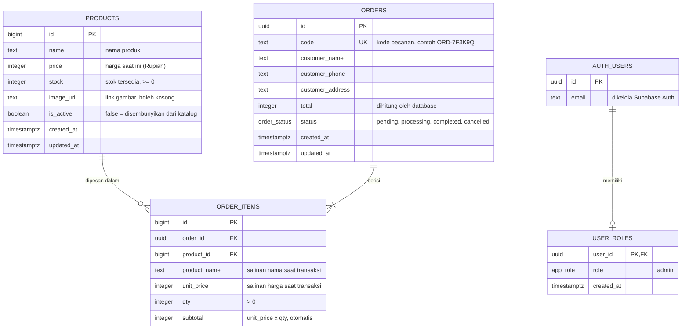

# ERD — Mini E-Commerce & Realtime Dashboard

| | |
|---|---|
| Versi | 1.1 (final) |
| Tanggal | 8 November 2026 |
| Penyusun | Arik |
| Database | PostgreSQL (Supabase) |
| Status | Final, sesuai `supabase/migrations/` |

## 1. Diagram



**Cara membaca relasi:**
- Satu **pesanan** berisi **satu atau lebih** rincian barang (`||--|{`). Inilah yang memungkinkan multi-produk dalam satu transaksi.
- Satu **produk** bisa muncul di **nol atau banyak** rincian pesanan (`||--o{`). Produk baru tentu belum pernah dipesan.
- `orders` dan `products` berhubungan *banyak-ke-banyak* lewat tabel penghubung `order_items`.

- Satu **akun** (`auth.users`) punya **nol atau satu** role (`||--o|`). Akun tanpa baris di `user_roles` tidak punya hak apa pun.

**Akun admin** disimpan dan dikelola oleh Supabase Auth (`auth.users`): email, password (hash), dan sesi login. Tabel ini milik Supabase, bukan dibuat sendiri. Hak akses ditentukan terpisah oleh tabel `user_roles`, sehingga **akun yang bisa login belum tentu admin**.

## 2. Kamus Data

### 2.1 `products` — data produk
| Kolom | Tipe | Aturan | Keterangan |
|-------|------|--------|------------|
| id | bigint | PK, otomatis | ID produk |
| name | text | wajib | Nama produk |
| price | integer | wajib, ≥ 0 | Harga saat ini dalam Rupiah (tanpa desimal) |
| stock | integer | wajib, ≥ 0 | Stok tersedia |
| image_url | text | opsional | Link gambar produk |
| is_active | boolean | default `true` | `false` = tidak tampil di katalog dan tidak bisa dipesan |
| created_at | timestamptz | default sekarang | Waktu dibuat |
| updated_at | timestamptz | default sekarang | Waktu terakhir diubah |

### 2.2 `orders` — data pesanan
| Kolom | Tipe | Aturan | Keterangan |
|-------|------|--------|------------|
| id | uuid | PK, otomatis | ID internal pesanan |
| code | text | wajib, unik | Kode pesanan untuk pelanggan, contoh `ORD-7F3K9Q` |
| customer_name | text | wajib | Nama pelanggan |
| customer_phone | text | wajib, hanya angka | Nomor HP format `62xxxx` (dinormalisasi `create_order`), juga dipakai untuk lacak pesanan |
| customer_address | text | wajib | Alamat pengiriman |
| total | integer | wajib, ≥ 0 | Jumlah seluruh subtotal, dihitung oleh database |
| status | order_status | default `pending` | Status pesanan (lihat 2.4) |
| created_at | timestamptz | default sekarang | Waktu pesanan dibuat |
| updated_at | timestamptz | default sekarang | Waktu status terakhir berubah |

### 2.3 `order_items` — rincian barang per pesanan
| Kolom | Tipe | Aturan | Keterangan |
|-------|------|--------|------------|
| id | bigint | PK, otomatis | ID rincian |
| order_id | uuid | FK → `orders.id`, hapus ikut pesanan | Pesanan induk |
| product_id | bigint | FK → `products.id`, tidak boleh dihapus jika masih dipakai | Produk yang dibeli |
| product_name | text | wajib | Salinan nama produk saat transaksi |
| unit_price | integer | wajib, ≥ 0 | Salinan harga satuan saat transaksi |
| qty | integer | wajib, > 0 | Jumlah dibeli |
| subtotal | integer | dihitung otomatis | `unit_price × qty` |

Kombinasi `order_id` + `product_id` dibuat unik, sehingga produk yang sama dalam satu pesanan cukup satu baris dengan qty dijumlahkan.

### 2.4 Tipe `order_status`
| Nilai | Arti |
|-------|------|
| `pending` | Menunggu diproses |
| `processing` | Sedang diproses |
| `completed` | Selesai |
| `cancelled` | Dibatalkan (stok dikembalikan) |

### 2.5 `user_roles` — role tiap akun
| Kolom | Tipe | Aturan | Keterangan |
|-------|------|--------|------------|
| user_id | uuid | PK, FK → `auth.users.id`, hapus ikut akun | Akun pemilik role; PK menjamin satu akun hanya punya satu role |
| role | app_role | wajib | Role akun (lihat 2.6) |
| created_at | timestamptz | default sekarang | Waktu role diberikan |

### 2.6 Tipe `app_role`
| Nilai | Arti |
|-------|------|
| `admin` | Akses penuh ke dashboard, pesanan, dan kelola produk |

Saat ini hanya ada satu role. Role baru (misalnya `staff` yang hanya boleh mengubah status pesanan) cukup ditambahkan sebagai nilai enum baru beserta aturan RLS-nya, tanpa mengubah struktur tabel.

## 3. Keputusan Desain

| Keputusan | Alasan |
|-----------|--------|
| Harga dan nama produk **disalin** ke `order_items` | Jika admin mengubah harga atau nama produk, pesanan lama tetap mencatat harga dan nama saat transaksi (PRD FR-22). |
| Produk **dinonaktifkan**, bukan dihapus (`is_active`) | Produk yang pernah dibeli masih dirujuk `order_items`; menghapusnya akan merusak riwayat pesanan. |
| `subtotal` dihitung otomatis oleh database | Tidak mungkin ada selisih antara subtotal dan `unit_price × qty`. |
| `total` dihitung oleh fungsi `create_order` | Browser tidak dipercaya untuk menghitung harga (PRD FR-05). |
| `code` terpisah dari `id` | `id` (UUID) panjang dan untuk internal; `code` pendek agar mudah dicatat pelanggan. |
| Uang memakai `integer` | Rupiah tidak memakai desimal, dan bilangan bulat terhindar dari masalah pembulatan. |
| Status memakai tipe enum | Database menolak nilai status di luar empat pilihan yang sah. |
| Tabel `orders` masuk publication `supabase_realtime` | Tanpa ini Supabase Realtime tidak mengirim perubahan pesanan ke dashboard. Pengiriman tetap tunduk pada RLS, jadi hanya admin yang menerimanya. |
| Role disimpan di tabel `user_roles`, terpisah dari akun | Akun yang bisa login belum tentu admin. Pencabutan role langsung berlaku (cukup hapus barisnya), dan relasinya terlihat jelas di ERD. Dibanding `app_metadata` Supabase Auth, role tidak tertunda sampai token diperbarui (±1 jam). |
| `user_roles` dipisah dari data profil | Tabel profil biasanya boleh diubah pemiliknya; jika role ada di tabel yang sama, satu aturan yang longgar membuat user bisa menjadikan dirinya admin. `user_roles` tidak punya aturan ubah untuk user sama sekali. |
| Satu role per akun (`user_id` sebagai PK) | Tidak ada kebutuhan satu orang memegang dua role; struktur lebih sederhana dan mudah diperiksa. |

## 4. Index
| Tabel | Kolom | Kegunaan |
|-------|-------|----------|
| orders | `code` (unik) | Pencarian kode di halaman lacak pesanan |
| orders | `customer_phone` | Pencarian nomor HP di halaman lacak pesanan |
| orders | `created_at` | Urutan tabel transaksi dan grafik omzet per hari |
| orders | `status` | Filter status di dashboard |
| order_items | `order_id` | Mengambil rincian sebuah pesanan |
| order_items | `product_id` | Grafik produk terlaris |

## 5. Hak Akses Data (Row Level Security)

| Tabel | Pelanggan (tanpa login) | Admin (login, role admin) |
|-------|-------------------------|---------------|
| products | Baca produk aktif saja | Baca semua, tambah, ubah (tanpa hapus) |
| orders | Tidak ada akses langsung | Baca, ubah status |
| order_items | Tidak ada akses langsung | Baca |
| user_roles | Tidak ada akses | Tidak ada akses langsung (hanya dibaca lewat `is_admin()`) |

"Admin" di tabel ini berarti user yang login **dan** punya baris `role = 'admin'` di `user_roles`. Aturan RLS memeriksanya lewat satu fungsi:

```sql
create function public.is_admin() returns boolean
language sql stable security definer set search_path = ''
as $$
  select exists (
    select 1 from public.user_roles
    where user_id = auth.uid() and role = 'admin'
  )
$$;

-- contoh pemakaian di aturan RLS
create policy "admin baca orders" on public.orders
  for select to authenticated using ((select public.is_admin()));
```

- `security definer`: fungsi berjalan dengan hak pemiliknya, sehingga bisa membaca `user_roles` walaupun tabel itu tertutup untuk user.
- `set search_path = ''`: fungsi tidak bisa dikelabui tabel bernama sama di schema lain.
- `(select ...)` di aturan RLS: pemeriksaan cukup dijalankan sekali per query, bukan per baris.

Role diberikan satu kali lewat SQL Editor Supabase:

```sql
insert into public.user_roles (user_id, role)
select id, 'admin' from auth.users where email = '<email admin>';
```

Pengamanan berlapis:
1. Pendaftaran akun publik di Supabase dimatikan, sehingga hanya akun yang dibuat manual yang ada.
2. Kalaupun ada akun lain yang terdaftar, akun itu tidak punya baris di `user_roles`, sehingga tetap tidak bisa membaca data pesanan.
3. `user_roles` tidak punya aturan tambah/ubah untuk user, sehingga role hanya bisa diberikan lewat SQL Editor.

Pencabutan role langsung berlaku: cukup hapus barisnya di `user_roles`, karena `is_admin()` memeriksa tabel di setiap request.

Pelanggan **tidak pernah menulis langsung** ke tabel. Semua perubahan pesanan lewat fungsi database (`security definer`, `set search_path = ''`):

| Fungsi | Boleh dipanggil | Isi |
|--------|-----------------|-----|
| `create_order(customer_name, customer_phone, customer_address, items)` | anon, authenticated | Membuat pesanan: harga dari database, kunci baris produk, cek dan kurangi stok, semuanya dalam satu transaksi. Mengembalikan kode pesanan dan total. |
| `track_orders(keyword)` | anon, authenticated | Keyword berawalan `ORD-` dicari sebagai kode, selain itu sebagai nomor HP (dinormalisasi). Mengembalikan daftar pesanan (kode, status, waktu, total, rincian), terbaru dulu, maksimal 20; tidak ketemu = `[]`. Nama, alamat, dan nomor HP tidak dikembalikan. |
| `update_order_status(order_id, new_status)` | authenticated, dicek `is_admin()` di dalam fungsi | Hanya perpindahan status yang sah (Flowchart §7); jika dibatalkan, stok dikembalikan dalam transaksi yang sama. |
| `get_dashboard_stats()` | authenticated, dicek `is_admin()` di dalam fungsi | Ringkasan dashboard: total omzet, jumlah pesanan, barang terjual, pesanan `pending`, omzet per hari 7 hari terakhir (zona Asia/Jakarta, hari kosong bernilai 0), dan top 5 produk per qty. Pesanan `cancelled` tidak dihitung di omzet, barang terjual, dan grafik; jumlah pesanan menghitung semua status. |
| `normalize_phone(phone)` | tidak ada (dipakai fungsi lain) | Menyamakan format nomor HP ke `62xxxx`: `0812…`, `+62 812-…`, dan `62812…` menjadi `62812…`. |

Nomor HP disimpan dalam bentuk yang sudah dinormalisasi, sehingga pelanggan tetap bisa melacak pesanan walaupun menulis nomornya dengan format berbeda.
