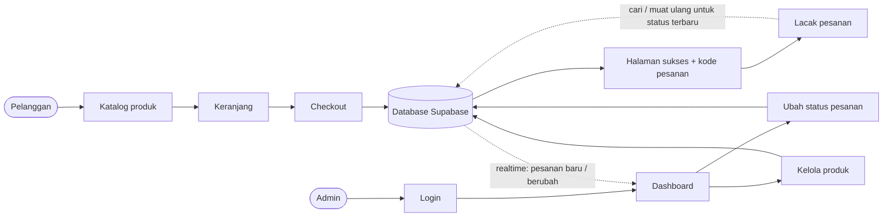
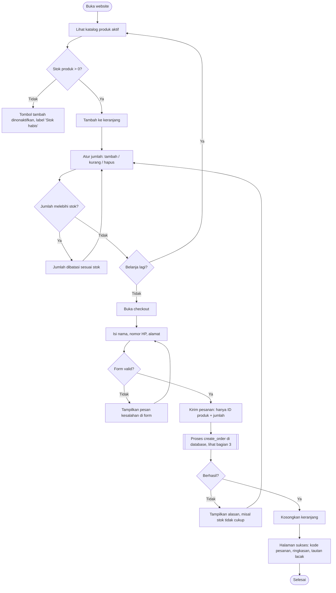
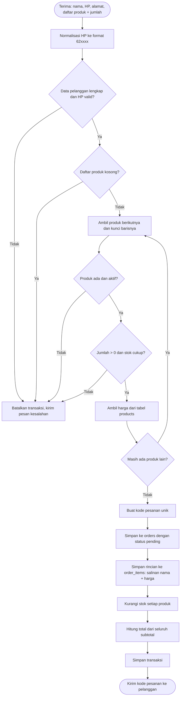
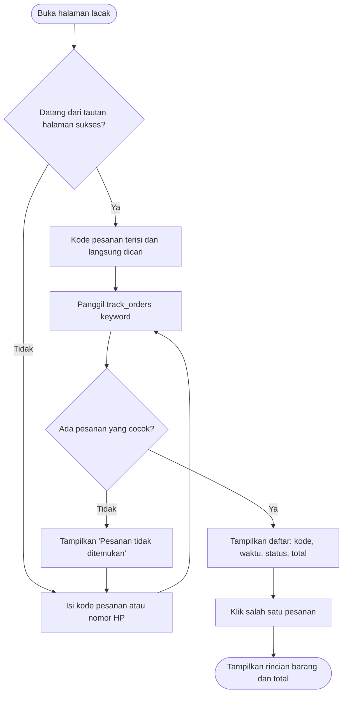
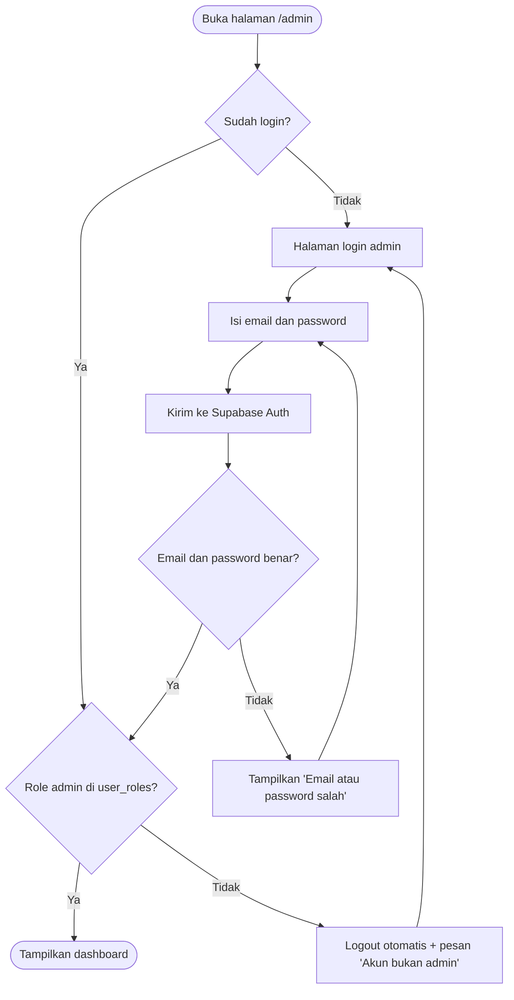
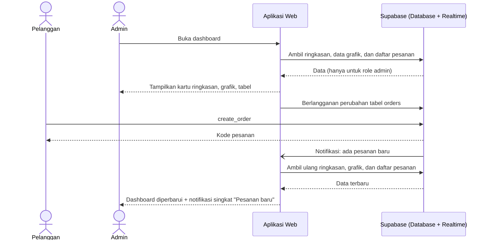
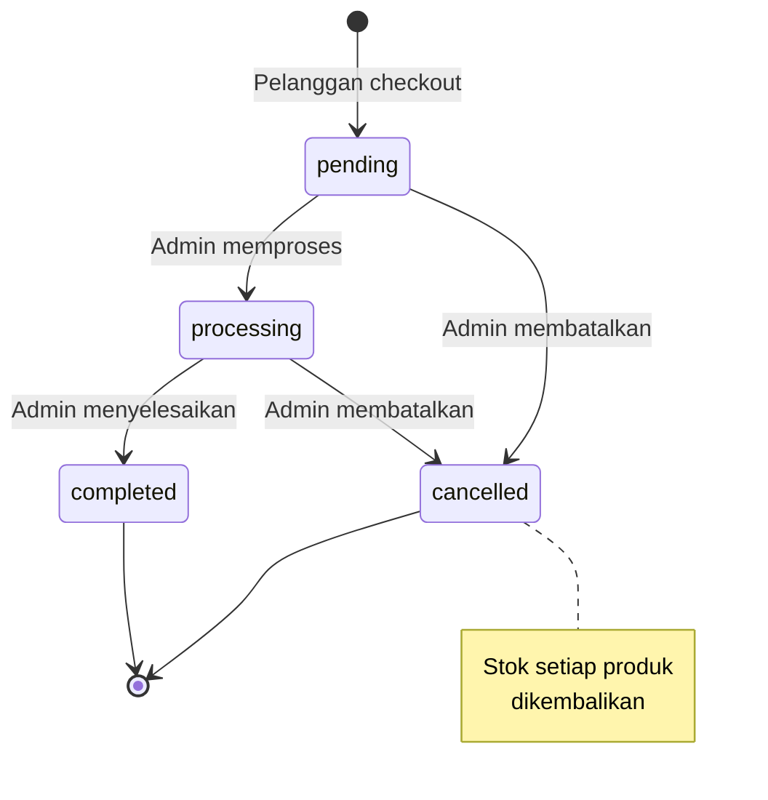
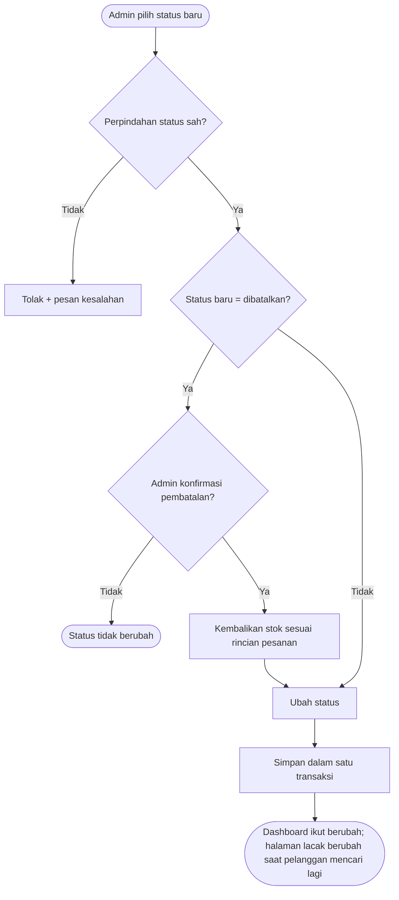
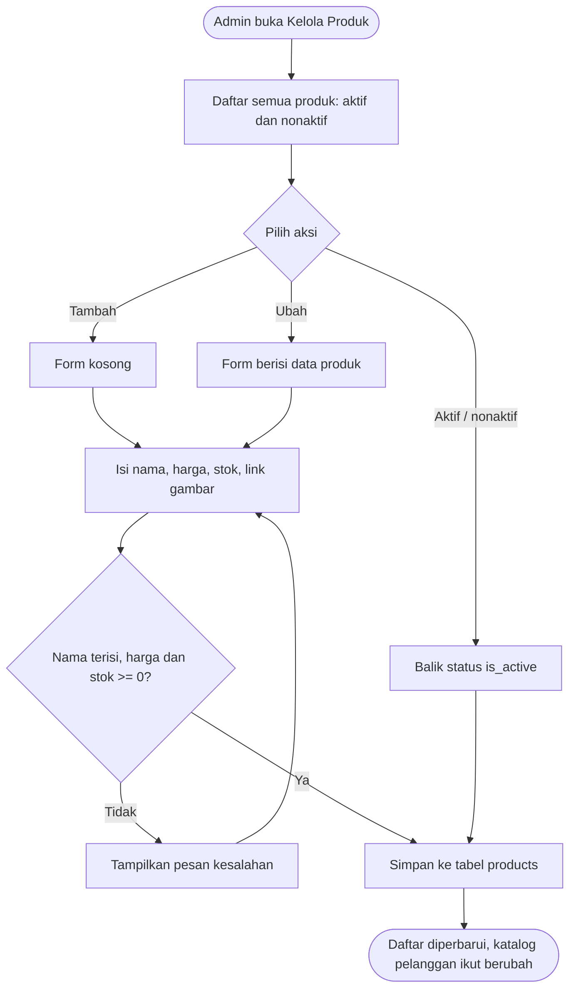

# Flowchart — Mini E-Commerce & Realtime Dashboard

| | |
|---|---|
| Versi | 1.1 (final) |
| Tanggal | 8 November 2026 |
| Penyusun | Arik |
| Acuan | PRD.md, ERD.md |
| Status | Final, sesuai aplikasi yang ter-deploy |

Dokumen ini menggambarkan alur sistem dari sisi pelanggan, database, dan admin.

## 1. Gambaran Umum

## 2. Alur Pelanggan: Belanja sampai Checkout

Keranjang disimpan di browser pelanggan, sehingga tidak hilang saat halaman dimuat ulang.

## 3. Proses `create_order` di Database

Seluruh langkah berjalan dalam **satu transaksi**. Jika satu langkah gagal, semua perubahan dibatalkan.

**Mengapa baris produk dikunci?** Jika dua pelanggan membeli stok terakhir pada detik yang sama, pelanggan kedua harus menunggu sampai transaksi pertama selesai. Setelah itu ia melihat stok sudah 0 dan pesanannya ditolak. Dengan begitu stok tidak pernah minus (PRD NFR-04).

## 4. Alur Lacak Pesanan

Kode pesanan selalu menghasilkan satu pesanan karena kode bersifat unik; nomor HP bisa menghasilkan beberapa pesanan. Status tidak diperbarui otomatis: pelanggan mencari lagi atau memuat ulang halaman untuk melihat status terbaru.

## 5. Alur Login & Akses Admin

Pemeriksaan role memakai fungsi database `is_admin()` dan dilakukan di dua tempat: di aplikasi (sebelum halaman admin dibuka) dan di database melalui RLS (sebelum data dikirim). Jadi walaupun pemeriksaan di aplikasi terlewati, data pesanan tetap tidak bisa dibaca.

## 6. Alur Dashboard Real-time

Admin tidak perlu memuat ulang halaman. Perubahan status oleh admin lain juga muncul dengan cara yang sama.

## 7. Alur Status Pesanan

Status hanya bisa maju. Pesanan yang sudah selesai atau dibatalkan tidak bisa diubah lagi. Aturan ini dijalankan oleh fungsi database `update_order_status` (hanya untuk admin), bukan oleh tampilan, sehingga tetap berlaku walaupun request dikirim langsung ke database.

## 8. Alur Kelola Produk

Halaman `/admin/products` ([issue #15](https://github.com/arikmhm/awm-fullstack/issues/15)). Tombol Tambah dan Ubah membuka form di dialog; tombol Aktifkan/Nonaktifkan langsung menyimpan.

Perubahan harga hanya berlaku untuk pesanan baru. Pesanan lama tetap memakai harga yang tersimpan di `order_items`.
