# Panduan Pengguna — Mini E-Commerce & Realtime Dashboard

| | |
|---|---|
| Versi | 1.0 |
| Tanggal | 8 November 2026 |
| Penyusun | Arik |
| Alamat website | https://awm-fullstack.vercel.app |

Panduan ini menjelaskan cara memakai website dari dua sisi:
- **Pelanggan**: memesan barang tanpa perlu membuat akun.
- **Admin (pemilik toko)**: memantau pesanan yang masuk dan memperbarui statusnya.

Semua gambar di panduan ini diambil dari website yang sudah online.

---

## Bagian A — Pelanggan

### A1. Melihat katalog produk
Buka https://awm-fullstack.vercel.app. Halaman utama menampilkan semua produk yang dijual, lengkap dengan gambar, harga, dan sisa stok.

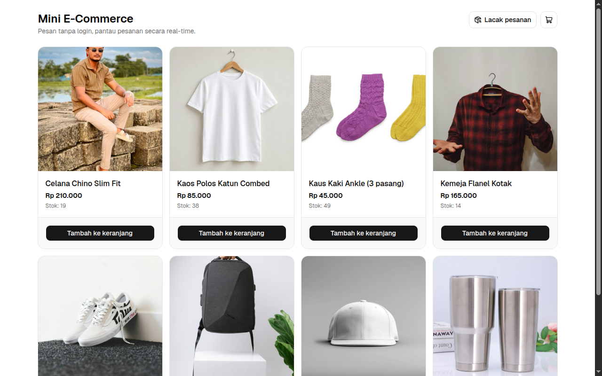

- Klik **Tambah ke keranjang** untuk memasukkan produk ke keranjang. Notifikasi kecil muncul sebagai tanda produk sudah masuk.
- Produk yang stoknya habis diberi label **Stok habis** dan tombolnya tidak bisa diklik.
- Tombol **Lacak pesanan** di kanan atas dipakai untuk mengecek pesanan yang sudah dibuat (lihat A5).

### A2. Mengatur keranjang
Klik ikon keranjang di kanan atas. Angka kecil di ikon itu menunjukkan jumlah barang di keranjang.

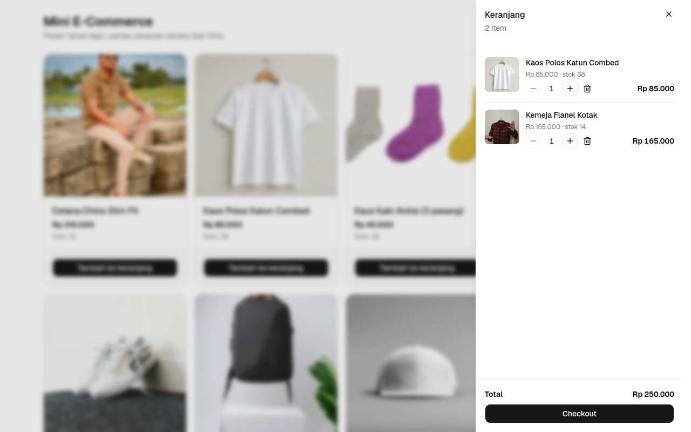

- Tombol **+** dan **−** menambah atau mengurangi jumlah. Jumlahnya tidak bisa melebihi stok yang tersedia.
- Ikon tempat sampah menghapus produk dari keranjang.
- Subtotal setiap produk dan **Total** dihitung otomatis.
- Isi keranjang tetap tersimpan walaupun halaman ditutup atau dimuat ulang.

Jika sudah selesai memilih, klik **Checkout**.

### A3. Checkout tanpa akun
Isi tiga data pengiriman berikut:

| Kolom | Keterangan |
|---|---|
| Nama | Nama penerima |
| Nomor HP | Boleh ditulis `0812…`, `+62 812…`, atau `62812…`; ketiganya dianggap nomor yang sama |
| Alamat | Alamat pengiriman lengkap |

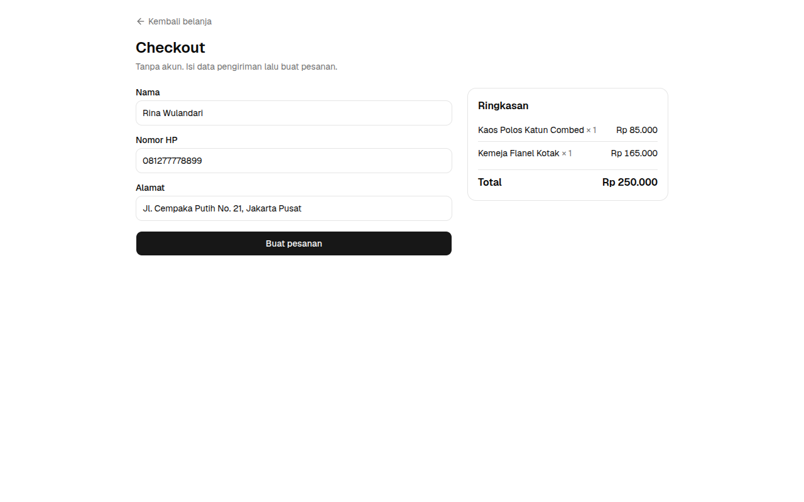

Bagian **Ringkasan** di sebelah kanan menampilkan barang dan total yang akan dibayar. Klik **Buat pesanan** untuk mengirim pesanan.

> Total selalu dihitung ulang oleh sistem dari harga produk yang berlaku, sehingga tidak bisa diubah dari browser. Jika stok habis karena dibeli orang lain lebih dulu, pesanan ditolak dengan pesan yang menjelaskan alasannya.

### A4. Halaman pesanan berhasil
Setelah pesanan dibuat, pelanggan mendapat **kode pesanan** (contoh: `ORD-GXMSVM`). **Simpan kode ini** untuk melacak pesanan nanti.

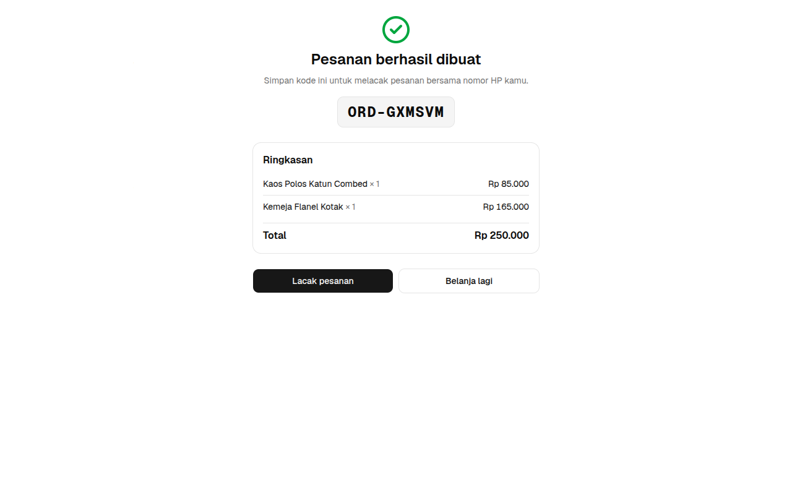

- **Lacak pesanan** membuka status pesanan ini.
- **Belanja lagi** kembali ke katalog. Keranjang sudah dikosongkan otomatis.

### A5. Melacak pesanan
Di halaman **Lacak pesanan**, ketik **kode pesanan** atau **nomor HP** yang dipakai saat checkout, lalu klik **Cari**.

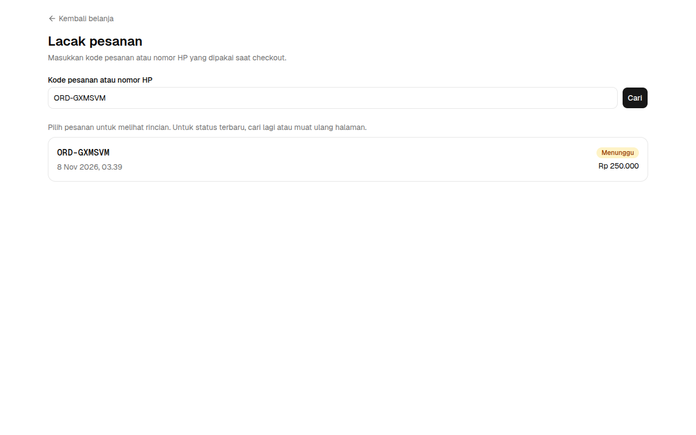

- Kode pesanan menampilkan satu pesanan. Nomor HP menampilkan semua pesanan dengan nomor tersebut, maksimal 20 pesanan terbaru.
- Setiap pesanan menampilkan kode, waktu, status, dan total. Nama, alamat, dan nomor HP tidak ditampilkan agar data pribadi tetap aman.
- Klik salah satu pesanan untuk melihat rincian barangnya:

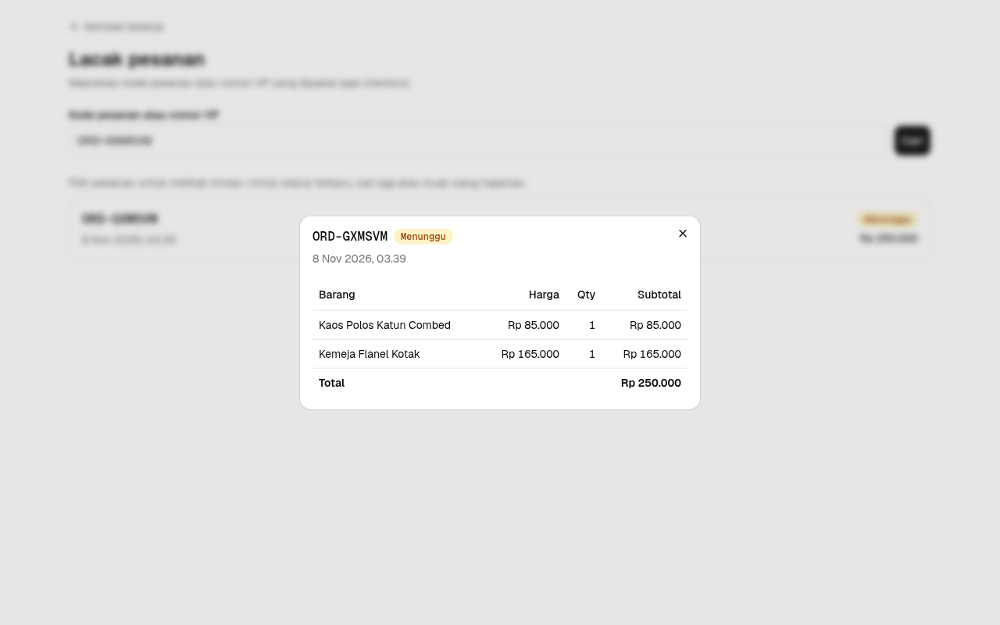

Status tidak berubah otomatis di halaman ini. Untuk melihat status terbaru, klik **Cari** lagi atau muat ulang halaman. Arti setiap status ada di [Bagian C](#bagian-c--arti-status-pesanan).

### A6. Tampilan di HP
Semua halaman bisa dipakai dengan nyaman di layar HP.

| Katalog | Keranjang |
|---|---|
| 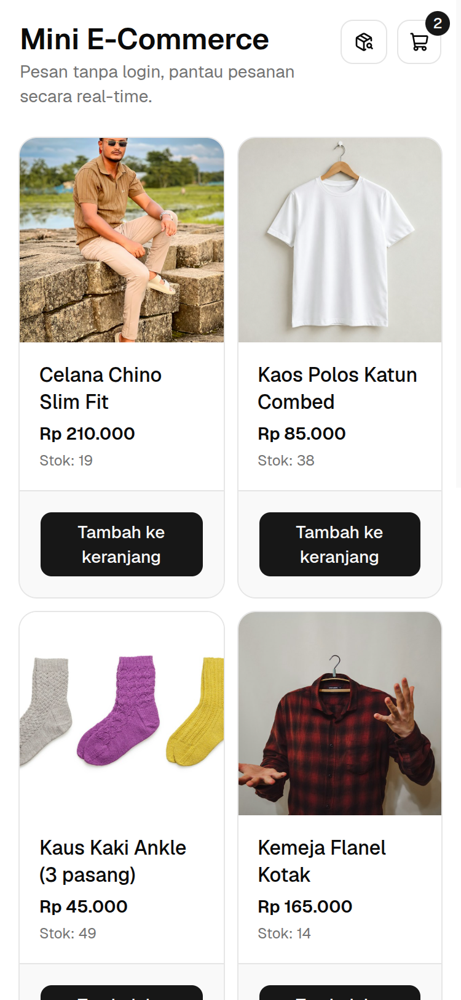 | 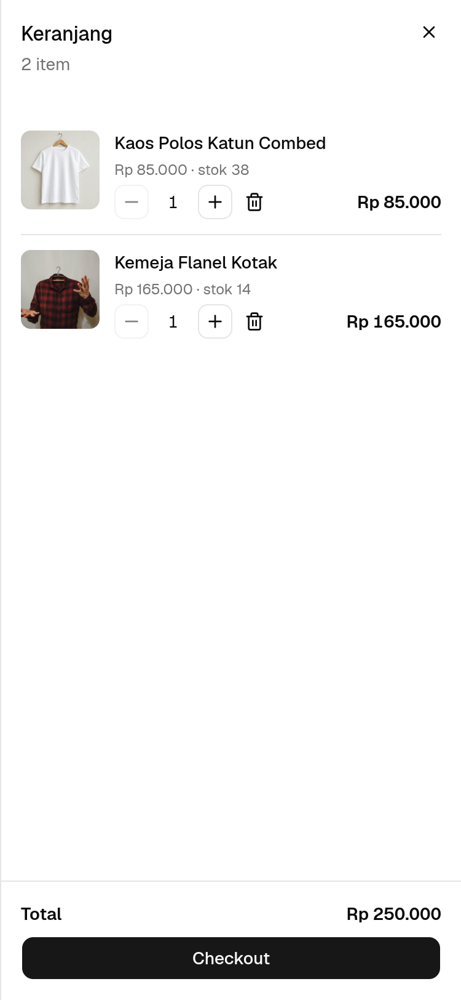 |

---

## Bagian B — Admin

### B1. Login
Buka https://awm-fullstack.vercel.app/admin. Jika belum login, halaman login admin akan muncul.

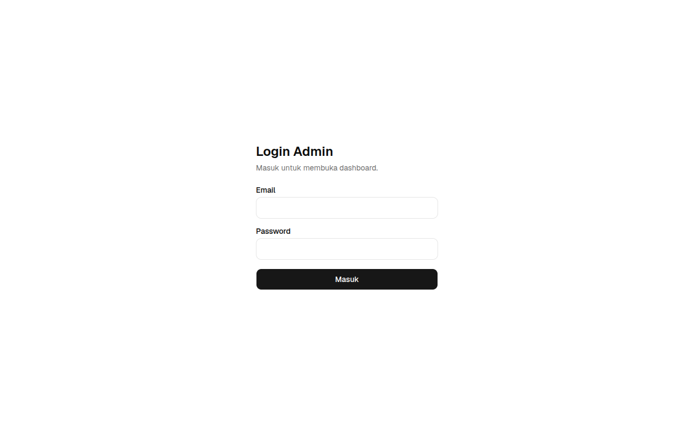

Masukkan email dan password admin, lalu klik **Masuk**.
- Jika email atau password salah, muncul pesan "Email atau password salah".
- Akun yang bisa login tetapi bukan admin akan otomatis dikeluarkan dengan pesan "Akun bukan admin".
- Cara membuat akun admin ada di [README](../README.md#4-buat-akun-admin).

### B2. Ringkasan dan grafik penjualan
Bagian atas dashboard menampilkan kondisi toko.

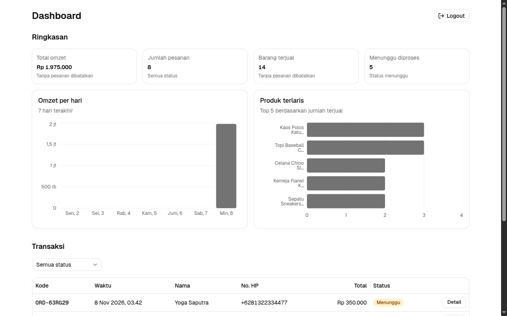

| Kartu | Arti |
|---|---|
| Total omzet | Jumlah uang dari semua pesanan, kecuali yang dibatalkan |
| Jumlah pesanan | Semua pesanan, termasuk yang dibatalkan |
| Barang terjual | Jumlah barang dari semua pesanan, kecuali yang dibatalkan |
| Menunggu diproses | Pesanan baru yang belum ditangani |

- **Omzet per hari**: total penjualan setiap hari selama 7 hari terakhir (waktu WIB).
- **Produk terlaris**: 5 produk dengan jumlah terjual terbanyak. Arahkan kursor ke batang grafik untuk melihat angka pastinya.

Tombol **Logout** di kanan atas dipakai untuk keluar dari dashboard.

### B3. Tabel transaksi dan filter status
Semua pesanan ada di tabel **Transaksi**, dengan pesanan terbaru di urutan teratas. Isinya kode, waktu, nama, nomor HP, total, dan status.

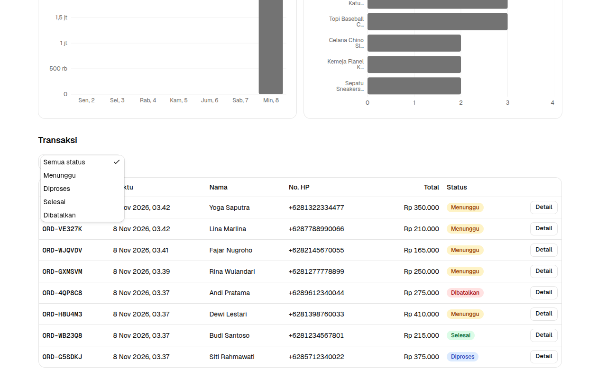

Klik pilihan **Semua status** untuk menampilkan pesanan dengan status tertentu saja, misalnya hanya yang **Menunggu**. Di HP, tabel bisa digeser ke samping.

### B4. Rincian pesanan dan ubah status
Klik **Detail** pada sebuah pesanan untuk melihat data pelanggan (nama, nomor HP, alamat) dan rincian barang yang harus disiapkan.

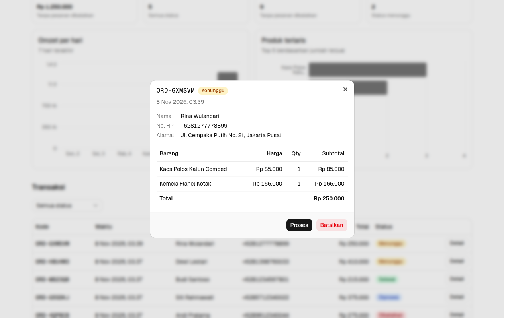

Tombol di bagian bawah menyesuaikan status pesanan saat ini:

| Status saat ini | Tombol yang tersedia |
|---|---|
| Menunggu | **Proses**, **Batalkan** |
| Diproses | **Selesaikan**, **Batalkan** |
| Selesai / Dibatalkan | Tidak ada (status sudah final) |

Sebelum membatalkan, sistem meminta konfirmasi "Batalkan pesanan? Stok akan dikembalikan." Klik **Ya, batalkan** untuk melanjutkan atau **Tidak** untuk kembali. Stok barang pada pesanan yang dibatalkan otomatis dikembalikan ke katalog.

### B5. Pesanan baru muncul otomatis
Dashboard tidak perlu dimuat ulang. Begitu pelanggan menyelesaikan checkout, notifikasi **"Pesanan baru: ORD-…"** muncul di pojok kanan bawah. Pesanan itu langsung tampil di urutan teratas tabel, dan angka ringkasan serta grafik ikut diperbarui.

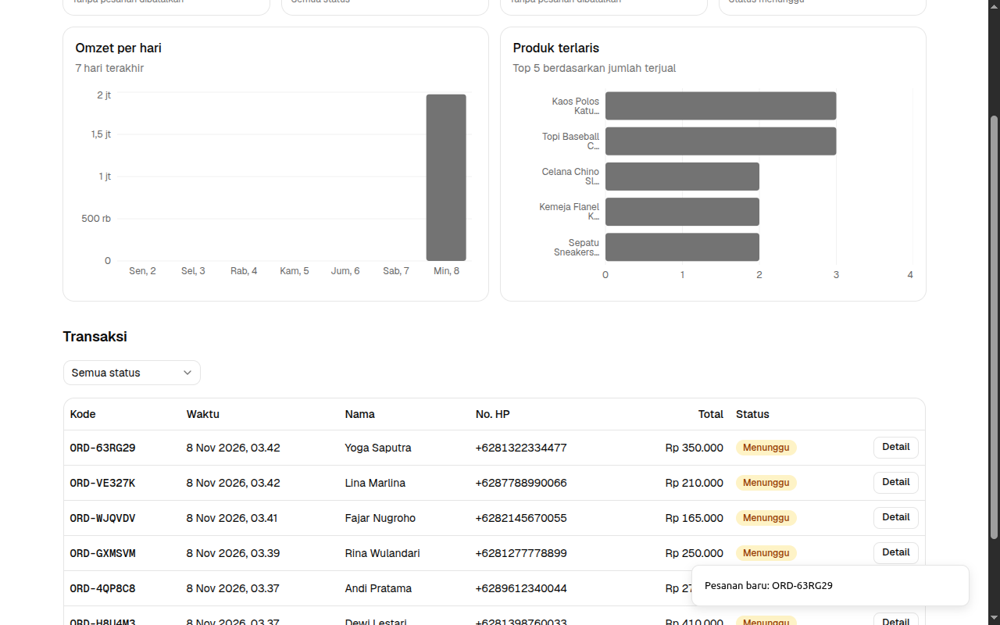

Perubahan status juga langsung terlihat di dashboard lain yang sedang terbuka.

---

## Bagian C — Arti Status Pesanan

| Status | Arti | Langkah berikutnya |
|---|---|---|
| **Menunggu** | Pesanan baru masuk dan belum ditangani | Admin memproses atau membatalkan |
| **Diproses** | Pesanan sedang disiapkan atau dikirim | Admin menyelesaikan atau membatalkan |
| **Selesai** | Pesanan sudah diterima pelanggan | — |
| **Dibatalkan** | Pesanan batal, stok dikembalikan | — |

Status hanya bisa bergerak maju. Pesanan yang sudah **Selesai** atau **Dibatalkan** tidak bisa diubah lagi.

## Bagian D — Pertanyaan Umum

**Apakah pelanggan perlu membuat akun?**
Tidak. Pelanggan cukup mengisi nama, nomor HP, dan alamat saat checkout.

**Bagaimana jika kode pesanan hilang?**
Lacak pesanan dengan nomor HP yang dipakai saat checkout.

**Bagaimana cara membayar?**
Pembayaran dilakukan di luar website (transfer atau COD) sesuai kesepakatan dengan toko. Setelah itu admin memperbarui status pesanan.

**Bisakah admin menambah atau mengubah produk dari dashboard?**
Belum. Fitur ini direncanakan di [issue #15](https://github.com/arikmhm/awm-fullstack/issues/15). Untuk sementara produk diubah lewat Supabase Table Editor.
